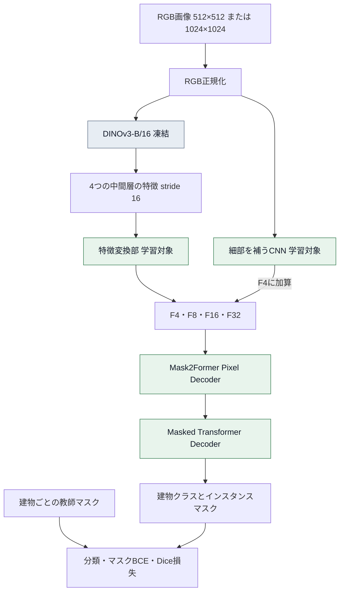

# DINOv3をバックボーンで凍結し、Mask2Formerで建物輪郭データセットを追加で学習する

[前回の記事](https://qiita.com/lehukuku0120/items/3e18285857ab2bd61e58)では、Detectron2版Mask2Formerを使い、DINOv3をバックボーンとして利用するための構成をまとめました。

今回は、**DINOv3を凍結した特徴抽出器として利用し、Mask2Formerで建物輪郭データセットを追加学習する方法**をまとめます。DINOv3が持つ事前学習済みの特徴を活用しながら、建物を見分けてマスクを生成する追加部分を学習する構成です。

学習にはWHU Building DatasetとWaterloo Building Datasetを使用し、1024×1024と512×512の画像を原寸のまま混在させます。この記事では、環境構築から始め、凍結範囲の実装、教師データの準備、収束を確認しながら学習を進める手順を順番に説明します。

## 学習環境を構築する

まず、Linuxサーバーに学習環境と実装一式を用意します。condaが利用でき、NVIDIAドライバーが導入されていることを前提に、コードの配置、環境構築、DINOv3のソースと重みの準備、動作確認の順に進めます。

### 前回と今回の実装の違い

凍結学習を実装するにあたり、今回はHugging Face Transformers版のMask2Formerを採用しています。前回のDetectron2用環境に設定を追加する手順とは、使用する実装が異なります。

| 項目 | 前記事の構築例 | 今回の学習構成 |
|---|---|---|
| Mask2Former | Detectron2と公式リポジトリ | Transformers 4.57.1の実装 |
| DINOv3 | ViT-L/16での単体確認例 | ViT-B/16を凍結して使用 |
| PyTorch／torchvision | 2.7.1／0.22.1 | 2.9.1／0.24.1 |
| Python／PyTorchのCUDA | 3.11／12.8 | 3.11／12.8 |
| conda環境 | `dino_m2f_pt271` | `dino-whu-m2f` |
| Deformable Attention | 独自CUDA拡張をビルド | PyTorch演算を使用 |
| 接続部分 | 未実装部分を含む雛形 | 特徴変換部とRGB補助CNNを実装 |

今回の構成では独自CUDA拡張のビルド工程を省いていますが、GPU計算にはCUDA対応のPyTorchを使用します。DINOv3とMask2Formerの接続部分も今回の実装で用意します。

### 今回確認した環境

| 項目 | 使用した構成 |
|---|---|
| OS | Linux |
| GPU | NVIDIA RTX PRO 6000 Blackwell Max-Q Workstation Edition |
| GPUメモリ | 公称96GB、PyTorchで約94.96GiB |
| Compute Capability | 12.0 |
| Python | 3.11 |
| PyTorch | 2.9.1+cu128 |
| torchvision | 0.24.1+cu128 |
| Transformers | 4.57.1 |
| conda環境名 | dino-whu-m2f |

PyTorchとtorchvisionは、[PyTorch公式の過去バージョン一覧](https://pytorch.org/get-started/previous-versions/)にあるCUDA 12.8版の組み合わせです。

### 実装一式を配置する

実装一式は[GitHubリポジトリ](https://github.com/Yuji-Kobayashi-orbitalnet/dinov3-mask2former-buildings)で公開しています。[記事対応版のZIPをダウンロード](https://github.com/Yuji-Kobayashi-orbitalnet/dinov3-mask2former-buildings/releases/download/v0.1.0/dinov3_mask2former_article_code.zip)し、サーバー側で `mkdir -p ~/zip` を実行してから `~/zip/` に転送してください。以下のコマンドでホームディレクトリに展開します。

```bash
cd ~
unzip -n ~/zip/dinov3_mask2former_article_code.zip
cd ~/dinov3_mask2former
sha256sum -c SHA256SUMS.article
```

```text
~/dinov3_mask2former/
├── environment.yml
├── requirements.txt
├── install_runtime.py
├── verify_env.py
├── SHA256SUMS.article
└── joint_native/
    ├── prepare_joint.py
    ├── waterloo_masks_to_coco.py
    ├── train_whu.py
    ├── create_initial_checkpoint.py
    ├── train_to_convergence.py
    └── sources_input.json
```

データセットの準備には `prepare_joint.py`、学習には `train_to_convergence.py` を使用します。いずれも本記事の実装一式に含まれています。

ZIPに画像、教師ラベル、DINOv3ソース、事前学習済み重みは含めません。`unzip -n` は既存ファイルを上書きしないため、すでに同じディレクトリで学習している環境を更新するコマンドとしては使いません。

### conda環境を作成する

```bash
cd ~/dinov3_mask2former
nvidia-smi
conda env create -f environment.yml
conda activate dino-whu-m2f
echo "$CONDA_DEFAULT_ENV"
python -c 'import sys; print(sys.executable)'
```

前回の記事では、PyTorch 2.7.1を固定するために `PIP_CONSTRAINT` を設定しました。この環境変数はconda環境を切り替えても残る場合があります。今回の新しい環境へインストールする前に、このシェルでは解除します。

```bash
unset PIP_CONSTRAINT
python install_runtime.py
```

この操作は前回のconstraintsファイルを削除・変更しません。以前の環境で再びビルドする場合は、前記事の手順に従って設定し直します。

`install_runtime.py` は対象の環境とPython 3.11を確認し、PyTorch 2.9.1のCUDA 12.8版と依存ライブラリを導入します。実際のバージョン一覧は `reports/installed-freeze.txt` に保存します。今回の構成では、GCC・nvcc・`TORCH_CUDA_ARCH_LIST` を設定して独自CUDA拡張をビルドする工程はありません。

### DINOv3-B/16のソースと重みを用意する

ソースの既定配置先は `~/repos/dinov3` です。まだそのディレクトリがない場合は、次のように取得します。

```bash
mkdir -p ~/repos ~/weights
git clone https://github.com/facebookresearch/dinov3.git ~/repos/dinov3
git -C ~/repos/dinov3 checkout 31703e4cbf1ccb7c4a72daa1350405f86754b6d1
```

コミットは今回の環境確認時に記録したものです。前記事の `$HOME/work/dino_m2f_setup/dinov3` を使う場合は、各スクリプトの `--dinov3-repo` にそのパスを指定します。継続学習ではチェックポイントに記録したコミットと一致させます。

重みの取得手続きは前回と同じく、[DINOv3公式の案内](https://github.com/facebookresearch/dinov3#pretrained-models)に従います。今回は**ViT-B/16のLVD-1689M重み**を取得し、次の名前で配置します。

```text
~/weights/dinov3_vitb16_pretrain_lvd1689m.pth
```

前記事のViT-L/16用重みは流用できません。今回の特徴変換部はB/16の768チャネルを前提にしています。また、Mask2FormerをTransformers版に変更しても、DINOv3の読み込みは公式実装の `torch.hub.load()` を使います。ここへ渡すのは公式実装向けの重みであり、Transformers形式の配布物を拡張子だけ変更して代用するものではありません。

上記は配置例のファイル名です。実際の保存名が異なる場合は、`--weights` にそのパスを指定します。

### GPUと各コンポーネントを確認する

```bash
cd ~/dinov3_mask2former
python verify_env.py --require-blackwell \
  --dinov3-repo "$HOME/repos/dinov3" \
  --weights "$HOME/weights/dinov3_vitb16_pretrain_lvd1689m.pth"
```

この確認は、GPUの認識、小型Swinを使ったMask2Formerの損失計算・逆伝播・更新、DINOv3の特徴抽出をそれぞれ調べます。DINOv3を接続した本学習の収束や精度を判定するものではありません。

今回の実行環境では、PyTorchのCUDA runtimeが12.8であり、512×512入力に対するDINOv3の4つの中間特徴が、それぞれ `[1, 768, 32, 32]` になることを確認しています。続いて、DINOv3の凍結範囲と入力処理を確認します。

## 凍結する部分と学習する部分

DINOv3には、事前学習済みのViT-B/16を使用します。DINOv3本体の重みを固定し、抽出された特徴を建物のインスタンスセグメンテーションに利用します。事前学習済みモデルと重みの取得方法は、[DINOv3公式リポジトリ](https://github.com/facebookresearch/dinov3)を参照してください。

Mask2Formerは[Hugging Face Transformers 4.57.1の実装](https://huggingface.co/docs/transformers/v4.57.1/en/model_doc/mask2former)を使用します。DINOv3と接続するための特徴変換部と、画像から細部を補う小さなCNNは独自に追加しています。



F4などの数字は、入力画像に対する特徴マップのストライドを表します。例えば1024×1024入力のF4は256×256です。

DINOv3の4つの中間特徴は、いずれもstride 16です。異なる解像度の特徴がそのまま出てくるわけではないため、1×1畳み込み、正規化、補間、プーリングで特徴ピラミッドへ変換します。高解像度側のF4には、RGB画像から作った補助特徴を加えます。

入力画像の原寸を保つことと、ネットワーク内部で特徴マップの解像度を変えることは別です。今回は入力画像と教師マスクのサイズを保持し、内部では通常の特徴抽出と解像度変換を行います。

| 部分 | 重みの扱い |
|---|---|
| DINOv3-B/16 | 事前学習済み重みを固定 |
| 特徴変換部 | 学習する |
| RGB画像から細部を補うCNN | 学習する |
| Mask2FormerのPixel Decoder | 学習する |
| Masked Transformer Decoderと分類・マスク生成部分 | 学習する |

新規開始時には、DINOv3以外の部分をランダム初期化します。既存チェックポイントから追加学習する場合は、そこに保存された学習部分の重みを引き継ぎます。

ここで生成する出力は建物ごとのマスクです。直線の辺、頂点、接続関係を持つベクトルポリゴンの生成は、この学習とは別の処理です。

## DINOv3だけを凍結する

特徴変換部まで一緒に凍結しないよう、DINOv3本体に対してだけ設定します。

```python
self.dino = dino.requires_grad_(False).eval()
```

学習モードに切り替えた場合も、DINOv3は評価モードを維持します。

```python
def train(self, mode=True):
    super().train(mode)
    self.dino.eval()
    return self
```

特徴抽出部分だけを `torch.no_grad()` で囲み、その後の特徴変換には勾配を流します。

```python
with torch.no_grad():
    taps = self.dino.get_intermediate_layers(
        pixel_values, n=[2, 5, 8, 11], reshape=True
    )

# この後のprojection、補助CNN、Mask2Formerは学習対象
```

optimizerへ渡すのは、学習対象のパラメータだけです。

```python
optimizer = torch.optim.AdamW(
    (p for p in model.parameters() if p.requires_grad),
    lr=1e-5,
    weight_decay=0.05,
)
```

この実装では学習対象を1グループにまとめています。Adapterだけにバックボーン用の学習率乗数を掛ける処理はありません。

接続部分の動作は、実Mask2Formerとパラメータを持つDINO代役を使ったCPUの1ステップでも確認しました。DINO側の重みは変わらず、特徴変換部、補助CNN、各Decoder、分類・マスク生成部分に勾配が流れて更新されました。

## RGBと正規化を統一する

画像はPILで読み込み、RGBへ変換します。

```python
pixels = torch.from_numpy(np.array(image.convert("RGB"))).permute(2, 0, 1)
```

その後、0〜255の値を0〜1に変換し、次の平均と標準偏差で正規化します。

```python
pixels = pixels.float() / 255.0
mean = pixels.new_tensor([0.485, 0.456, 0.406]).view(3, 1, 1)
std = pixels.new_tensor([0.229, 0.224, 0.225]).view(3, 1, 1)
pixels = (pixels - mean) / std
```

これは[DINOv3公式の正規化設定](https://github.com/facebookresearch/dinov3/blob/main/dinov3/data/transforms.py)に合わせたものです。0〜255の値に対して平均 `[123.675, 116.28, 103.53]`、標準偏差 `[58.395, 57.12, 57.375]` を使う計算と同等です。

Detectron2の `INPUT.FORMAT` などの設定は使わず、データローダーと正規化関数で明示します。

## WHUとWaterlooを原寸のまま準備する

データセットは、[WHU Building Datasetの配布元](https://gpcv.whu.edu.cn/data/building_dataset.html)と[Waterloo Building Datasetの配布ページ](https://doi.org/10.7910/DVN/EXRA2V)から取得します。この記事の件数と画像サイズは、今回サーバーに配置したデータについて確認した値です。

| データセット | 訓練画像数 | 検証画像数 | 今回使用する画像サイズ |
|---|---:|---:|---|
| WHU | 2,943 | 627 | 1024×1024 |
| Waterloo | 42,147 | 6,887 | 512×512 |
| 合計 | 45,090 | 7,514 | 原寸を混在させる |

WHUには複数の配布形式・解像度があります。すべてのWHU画像が1024×1024であるという意味ではありません。手元のファイルを確認してから設定します。

今回の配置は次のとおりです。

```text
/mnt/nas02/
├── WHU_Building_Dataset/
│   ├── train/
│   │   ├── images/
│   │   └── masks/
│   └── val/
│       ├── images/
│       └── masks/
└── Waterloo_Building_Dataset/
    ├── train/
    │   ├── image/
    │   └── label/
    └── validation/
        ├── image/
        └── label/
```

Waterlooなどのアーカイブを展開した直後には、`train/train/image` のように同名フォルダが入れ子になる場合があります。準備スクリプトで実際の構成を確認します。

```bash
cd ~/dinov3_mask2former/joint_native
python prepare_joint.py --inspect
```

画像フォルダの候補、件数、サンプル画像のサイズが表示されます。ここでは、WHUが1024×1024、Waterlooが512×512であることを確認します。すべての画像の寸法は、続く変換処理でも検査します。

### 使用するラベルを明示する

`prepare_joint.py` は既存の `annotations.json` があると、そのCOCO注釈を優先します。今回はラスタの教師マスクを使用するため、`sources_input.json` に `labels` のパスを明示します。

```json
{
  "whu": {
    "train": {
      "images": "/mnt/nas02/WHU_Building_Dataset/train/images",
      "labels": "/mnt/nas02/WHU_Building_Dataset/train/masks"
    },
    "validation": {
      "images": "/mnt/nas02/WHU_Building_Dataset/val/images",
      "labels": "/mnt/nas02/WHU_Building_Dataset/val/masks"
    }
  },
  "waterloo": {
    "train": {
      "images": "/mnt/nas02/Waterloo_Building_Dataset/train/image",
      "labels": "/mnt/nas02/Waterloo_Building_Dataset/train/label"
    },
    "validation": {
      "images": "/mnt/nas02/Waterloo_Building_Dataset/validation/image",
      "labels": "/mnt/nas02/Waterloo_Building_Dataset/validation/label"
    }
  }
}
```

既存の訓練・検証分割を保ち、統合したCOCO形式の索引を生成します。

```bash
python prepare_joint.py \
  --config sources_input.json \
  --output prepared_joint_native
```

```text
prepared_joint_native/
├── train.json
├── validation.json
└── sources.json
```

この処理は元画像をコピーせず、NAS上の画像への参照と注釈を保存します。各画像には、WHUとWaterlooを区別する `source` も記録します。

### 二値マスクをインスタンスに変換する際の制約

ラスタラベルは、8近傍でつながった建物領域を1つのインスタンスとして扱い、COCOの圧縮RLE形式で保存します。輪郭をポリゴンに近似する工程は挟みません。

教師ラベルは背景を0、建物を1・255・65535のいずれか1種類で表した二値マスクとします。画像とラベルのファイル名対応、寸法、二値の値域を検査します。合成データでは、穴や複数の成分を持つマスクが変換後も同じ画素として復元されることを確認しています。

ただし、隣接する建物がマスク上で接触している場合、1つの成分になります。ここで作る教師データは、二値マスクの連結成分に基づくインスタンスです。独立した建物を正確に分離したベクトル注釈と同一とは限りません。

変換処理は、画像とラベルの位置ずれや建物の誤結合を自動修復しません。学習前のデータ確認として、両データセットの画像と教師マスクを重ねて確認することも推奨します。これはモデルの精度評価とは別の確認です。

## クエリ数と原寸混在バッチを設定する

Mask2Formerのクエリ数は、1枚の画像に対して用意する予測枠の数です。今回のように建物が密集する画像では、既定の100を超える正解インスタンスが存在します。

今回は `num_queries=158` としました。別のデータを使う場合は、訓練・検証の最大インスタンス数を確認して決めます。現在のデータローダーは、正解数がクエリ数を超える画像を見つけると、学習開始前に停止します。

画像サイズについては、512×512の画像同士、1024×1024の画像同士でバッチを作ります。1つのバッチ内のサイズを合わせるための拡大・縮小やパディングは行いません。

今回の設定は実バッチサイズ1、勾配蓄積8です。原則として8画像分の勾配を蓄積して1回更新し、エポック末尾の残りが8未満の場合はその枚数で更新します。訓練時には画像とマスクを同時に90度単位で回転・反転します。

各画像は1エポックにつき1回使用します。画像数の比率はWHUが約6.5%、Waterlooが約93.5%であり、両者を50対50に再サンプリングする構成ではありません。

## 収束を確認しながら学習する

学習回数を固定して終えるだけでは、十分に学習できたかは判断できません。そこで、学習中は訓練損失と検証損失を監視し、詳細な精度評価は収束判定後に実行する構成にしました。

| 項目 | 今回の設定 |
|---|---|
| 精度形式 | FP32 |
| 実バッチサイズ | 1 |
| 勾配蓄積 | 8 |
| DataLoader workers | 2 |
| optimizer | AdamW |
| 開始時の学習率 | 1e-5 |
| weight decay | 0.05 |
| 勾配ノルムの上限 | 1.0 |
| DINOv3 | 全層凍結 |
| 損失 | 分類、マスクBCE、Dice、中間層の補助損失 |

`1e-5` は今回の追加学習で採用した値です。事前の `1e-4` の実行では途中から訓練損失が増加し、低い学習率での追加学習では損失が改善しました。初回学習や別のデータセットでも最適な値であると決めつけず、損失の推移を確認します。

### 検証損失の集計方法

検証ではデータ拡張を無効にし、損失計算に使う点サンプリングの乱数を固定します。WHUとWaterlooそれぞれで画像当たりの検証損失を平均し、その2つを同じ重みで平均します。

```text
監視する検証損失
  = (WHUの平均検証損失 + Waterlooの平均検証損失) / 2
```

画像枚数の多いWaterlooだけでモデル選択が決まらないようにするためです。これはモデル選択時の集計方法であり、訓練画像のサンプリング比率を変更するものではありません。

### 学習率の調整と停止条件

- 検証損失が相対0.1%以上改善しない状態が3エポック続いたら、学習率を半分にする。

- 学習率の下限は `1e-7` とする。

- 相対0.1%以上の改善が8エポック続けてなく、最後の学習率変更から2エポック以上経過したら、検証損失が停滞したと判定する。

- 小さな改善も含め、検証損失が最小になった重みを `best_loss.pt` に保存する。

この停止条件は、検証損失の停滞を使った運用上の収束判定です。数学的な大域最適解への到達を保証するものではありません。

収束判定後に `best_loss.pt` を読み込み、APと境界IoUを計算します。途中の各エポックでは詳細評価を実行しません。ここでの「最良モデル」は、監視している検証損失が最小だったモデルを意味します。

## tmux内で学習を開始する

SSH接続が切れても学習プロセスを維持できるよう、tmuxのセッションを作ります。

```bash
tmux new -s dino-m2f
```

作成したセッション内で環境と作業ディレクトリを設定します。

```bash
conda activate dino-whu-m2f
cd ~/dinov3_mask2former/joint_native
```

### 初めて学習する場合

収束確認用の `train_to_convergence.py` は、初期化元のチェックポイントを受け取ります。既存の学習済み重みを持っていない場合は、事前学習済みDINOv3とランダム初期化した学習部分から、epoch 0のチェックポイントを作成します。

```bash
python create_initial_checkpoint.py \
  --num-queries 158 \
  --output checkpoints/initial_q158.pt
```

この初期化スクリプトはCPUでモデルを構築して初期値を保存します。画像の学習や精度評価は行いません。

```bash
python -u train_to_convergence.py \
  --init-weights checkpoints/initial_q158.pt \
  --batch-size 1 --accumulation 8 --workers 2 \
  --lr 1e-5 --epochs 50 \
  --output runs/joint_native_convergence
```

### 既存の学習済み重みから追加学習する場合

筆者の環境では、事前の試行で得た `runs/joint_native_lr1e5_trial/best.pt` を起点に追加学習します。こちらは、初回開始コマンドの代わりに実行します。

```bash
python -u train_to_convergence.py \
  --init-weights runs/joint_native_lr1e5_trial/best.pt \
  --batch-size 1 --accumulation 8 --workers 2 \
  --lr 1e-5 --epochs 50 \
  --output runs/joint_native_convergence
```

`--init-weights` には、今回の実装で保存した統合モデル用チェックポイントを指定します。前記事のDetectron2用チェックポイントやDINOv3単体の重みをそのまま指定するものではありません。学習部分の重みを読み込み、optimizerを新しく作って開始します。画像サイズとクエリ数はチェックポイントから継承し、DINOv3のソースコミットと重みのSHA256が一致することも確認します。開始時には、初期化元の検証損失を測り、その重みも最良モデルの候補として保存します。

`--output` には新しいディレクトリを指定します。既存の実行を継続する場合は、次の `--resume` を使用します。

### 学習を再開する場合

```bash
python -u train_to_convergence.py \
  --resume runs/joint_native_convergence/last.pt \
  --batch-size 1 --accumulation 8 --workers 2 \
  --lr 1e-5 --epochs 100 \
  --output runs/joint_native_convergence
```

`--resume` はoptimizer、学習率調整器、停滞回数などを復元します。学習率が自動で下がっていても、コマンドの `--lr` には開始時に指定した値を入れます。実際の再開時の学習率は保存状態から復元されます。

`--epochs 100` は追加100回という意味ではなく、この実行系列で到達するエポック番号の上限です。チェックポイントは各エポックの検証損失計測後に保存するため、エポック途中で止まった場合はそのエポックをやり直します。

tmuxから離れるときは `Ctrl+b` の後に `d`、戻るときは次を実行します。

```bash
tmux attach -t dino-m2f
```

## 学習中に確認するファイル

| ファイル | 内容 |
|---|---|
| `loss_history.jsonl` | 訓練損失、データセット別検証損失、監視値、学習率、更新回数 |
| `last.pt` | 最新の完了エポックから再開するための状態 |
| `best_loss.pt` | 検証損失が最小だった学習部分の重みと状態 |
| `training_status.json` | 収束判定、停止理由、最終評価の完了状況 |
| `final_metrics.json` | 収束判定後に最良モデルで計算した評価結果 |

```bash
tail -n 3 runs/joint_native_convergence/loss_history.jsonl
cat runs/joint_native_convergence/training_status.json
```

`--epochs 50` に達しても、停止条件を満たしていなければ `converged` は `false`、停止理由は `epoch_limit` になります。この場合は詳細評価を実行せず、上限を増やして学習を再開します。

凍結したDINOv3の重みはチェックポイントへ重複保存しません。再開・推論に必要なDINOv3の元の重みファイルと、対応するソースも保管します。

## 収束後に確認する内容

学習中は損失と学習率を追い、停止条件を満たした後に、WHU・Waterlooそれぞれの建物マスクと輪郭を評価します。

最終評価の標準Mask APは、画像当たり上位100件の予測を使います。これは学習時の158クエリとは別の上限です。100棟を超える密集画像については、この上限を踏まえて検出漏れを確認します。

境界IoUはMask IoU 0.5以上で対応した予測と正解のペアについて計算するため、未検出の建物はその平均に入りません。また、境界幅2ピクセルが表す地上距離は画像の解像度によって異なります。輪郭の一致度だけでなく、建物の検出数や密集地域での取りこぼしも合わせて確認する予定です。
